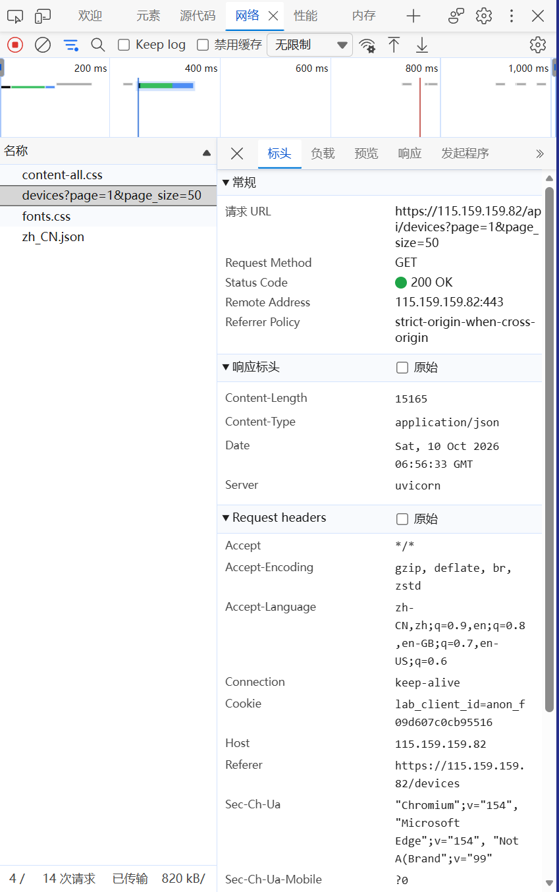
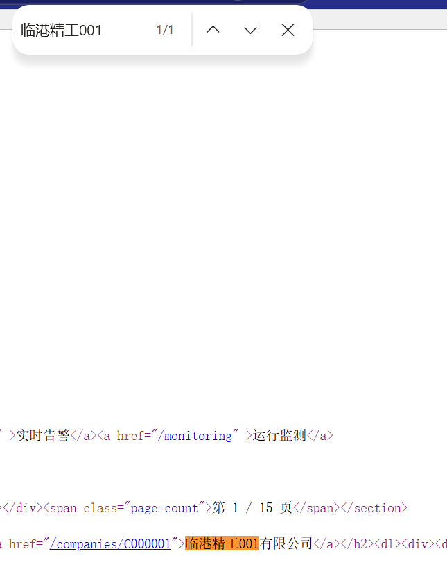
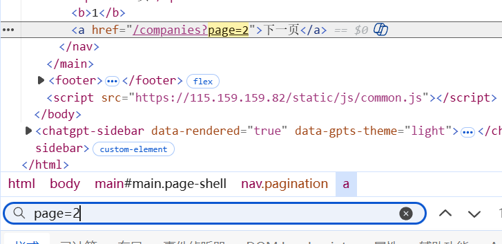
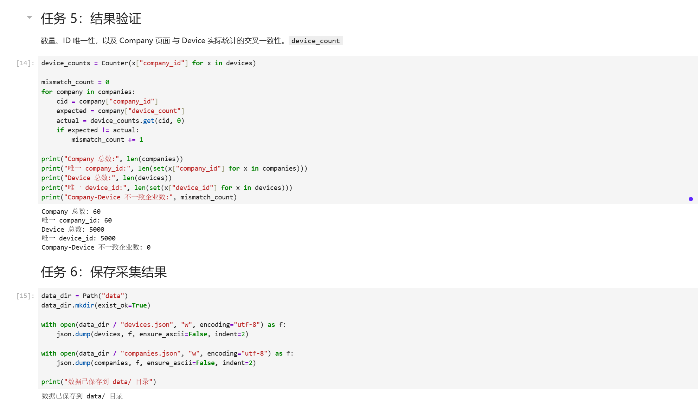

# Lab 1 实验报告

## 学生信息

- **姓名：** 鲁嘉睿
- **学号：** 112404260130
- **班级：** 数据1241
- **GitHub 用户名：** （填你自己的）
- **仓库地址：** （填你的仓库地址）

> 文件位置：`lab01/REPORT.md`
> 完整代码保存在 `lab1_html_api.ipynb`。

---

# 任务 1：判断数据加载方式

## 1.1 Device：判断动态加载并找到 API

### 判断结果

- 页面：`/devices`
- 数据加载方式：**动态加载**
- 判断依据：

在"查看网页源代码"中**搜不到**页面上显示的设备名称（如 `循环泵-000001-001`），源码里设备表格的位置只有一行占位内容
`<tbody id="device-rows"><tr><td colspan="8" class="loading-cell">正在加载…</td></tr></tbody>`，
说明设备数据不是随初始 HTML 一起返回的。在 Network 的 Fetch/XHR 中刷新页面后能找到返回设备数据的请求
`GET /api/devices?page=1&page_size=50`，响应为 JSON，因此该页面为动态加载。

### API 信息

- Request URL：`https://115.159.159.82/api/devices`
- Request Method：`GET`
- Query 参数：`page=1&page_size=50`

### 【截图 1】Device API 发现证据

文件名：

```text
images/01_device_api.png
```

插入：

```markdown

```

---

## 1.2 Company：判断静态加载

- 页面：`/companies`
- 数据加载方式：**静态加载**
- 判断依据：

使用"右键 → 查看网页源代码"后，按 `Ctrl + F` 搜索页面中真实显示的企业名称（如"临港精工001有限公司"）**能够直接搜到**，
并且源代码中以 `<article class="company-card" data-company-id="C000001">…</article>` 的完整结构出现在 HTML 里，
说明企业数据是随初始 HTML 一起返回的，可直接用 requests + BeautifulSoup 解析。

### 【截图 2】Company 静态加载证据

文件名：

```text
images/02_company_source.png
```

插入：

```markdown

```

---

# 任务 2：Device API 分页采集

## 2.1 API 分页结构

| 含义   | JSON 字段     |
| ---- | ---------- |
| 当前页  | `page`     |
| 每页条数 | `page_size` |
| 设备总数 | `total`    |
| 设备列表 | `items`    |

---

## 2.2 关键代码

```python
# 从第一页响应中读取分页信息
total = data["total"]
page_size = data["page_size"]

total_pages = (total + page_size - 1) // page_size

devices = []

for page in range(1, total_pages + 1):
    r = requests.get(
        api_url,
        params={
            "page": page,
            "page_size": page_size
        },
        timeout=10
    )

    page_data = r.json()
    page_items = page_data["items"]
    devices.extend(page_items)
```

---

## 2.3 采集结果

- 每页条数：50
- 设备总数：5000
- 程序计算得到的总页数：100
- 最终采集设备数：5000
- 唯一 `device_id` 数：5000

回答：

> 为什么总页数应由 API 返回的 `total` 和 `page_size` 计算，而不是直接在代码里写死？

答：写死页数等于把"数据量"当成永不变化的常量。一旦服务端调整 `page_size` 或新增设备，`total` 变了而代码没变，
就会出现少采（漏数据）或多取空页（请求报错）的情况。用 `total` 和 `page_size` 动态计算总页数，代码才能随数据量自适应，
也让"采集是否完整"这件事可以由程序自己推导和验证。

---

# 任务 3：Company HTML 解析

## 3.1 企业记录 Selector

- 企业记录 selector：`article.company-card`
- 第 1 页企业记录数：20

说明为什么选择这个 selector：

- 主要使用了 `class`（配合标签名 `article`）。
- 没有参考浏览器的 Copy selector，而是直接看 DOM 结构后手写。
- 最终采用现在这个写法，是因为 `company-card` 是"一条企业记录"最外层节点上语义明确的 class，
  定位不依赖它在页面中的位置。浏览器 Copy selector 生成的 `nth-child(...)` 长路径只要页面插入一条记录就会失效，
  而 `article.company-card` 短、稳定、可读性也好。

答：见上。

---

## 3.2 关键代码

```python
cards = soup.select("article.company-card")

card = cards[0]

company_id = card.get("data-company-id")
name = card.select_one("h2 a").get_text(strip=True)
status = card.select_one(".badge")["class"][-1]
```

行业、区域、设备数量使用 `dt/dd` 结构后，请写出你最终如何得到：

```python
details = {
    item.select_one("dt").get_text(strip=True): item.select_one("dd").get_text(strip=True)
    for item in card.select("dl > div")
}

industry = details["所属行业"]
zone = details["所在区域"]
device_count = int(details["设备数量"].replace("台", "").strip())
```

---

## 3.3 字段来源说明

1. 字段：`company_id`
   - 来自：`HTML 属性`
   - 使用的方法：`card.get("data-company-id")`，直接在记录节点的属性里取值。
2. 字段：`name`
   - 来自：`文本`
   - 使用的方法：先 `card.select_one("h2 a")` 定位标题链接，再 `.get_text(strip=True)` 取纯文本。

---

# 任务 4：Company "下一页"分页

## 4.1 下一页元素

- "下一页" selector：`nav.pagination a:last-of-type`
- 第 1 页 `href` 示例：`/companies?page=2`

> 注意：第 1 页的"上一页"是 `<span>`，第 2 页起才变成 `<a>`。
> 若写成 `nav.pagination a`，在第 2 页会取到"上一页"，导致程序在 1↔2 页之间反复横跳。

### 【截图 3】Company "下一页"元素

文件名：

```text
images/03_company_next.png
```

插入：

```markdown

```

---

## 4.2 关键代码

```python
next_link = soup.select_one("nav.pagination a:last-of-type")

next_href = next_link.get("href")

next_url = urljoin(
    current_url,
    next_href
)
```

再用 2～3 句话说明：

> 你的程序如何完成"当前页 → 找下一页 href → 请求下一页 → 再解析"的循环？

答：每一轮循环先用 `requests.get(current_url)` 请求当前页 HTML，用 `article.company-card` 解析出本页 20 条企业记录并追加到结果列表；
接着从 `nav.pagination a:last-of-type` 取出"下一页"链接的 `href`，用 `urljoin` 拼成绝对 URL 后赋给 `current_url`，
作为下一轮的请求地址。循环执行 3 次后结束，共得到 60 条企业记录。

---

## 4.3 三页采集结果

| 页码     | 企业数 |
| ------ | --: |
| 1      |  20 |
| 2      |  20 |
| 3      |  20 |
| **合计** |  60 |

- 唯一 `company_id` 数：60

---

# 任务 5：结果验证

## 5.1 最终结果

| 检查项                     |  结果 |
| ----------------------- | --: |
| Company 总数              |  60 |
| 唯一 `company_id`         |  60 |
| Device 总数               | 5000 |
| 唯一 `device_id`          | 5000 |
| Company–Device 不一致企业数   |   0 |

### 【截图 4】最终验证结果

文件名：

```text
images/04_validation.png
```

插入：

```markdown

```

---

## 5.2 一致性检查关键代码

```python
from collections import Counter

device_counts = Counter(
    x["company_id"] for x in devices
)

mismatch_count = 0

for company in companies:
    cid = company["company_id"]
    expected = company["device_count"]
    actual = device_counts.get(cid, 0)

    if expected != actual:
        mismatch_count += 1
```

回答：

> 为什么 `status_code == 200` 仍然不能说明"数据已经采集正确"？

答：200 只能说明"服务器成功返回了一个响应"，并不保证返回的内容正是想要的数据。例如分页参数写错时接口可能返回 200 加一个空列表；
翻页逻辑出错时也可能每页都请求成功，但实际只采到第 1 页；登录失效或触发反爬时甚至可能返回 200 加一段 HTML 错误页，
`.json()` 直接抛异常。因此必须用采集数量、ID 唯一性和跨数据源一致性这些**对数据内容本身**的校验来证明采集正确，
而不是只看状态码。

---

# 任务 6：保存采集结果

- `companies.json`：**已生成**
- `devices.json`：**已生成**

---

# 实验结论

静态加载页面的数据随初始 HTML 一起返回，直接请求 URL 后用 BeautifulSoup 解析 DOM、按 CSS Selector 提取字段即可；
动态加载页面的初始 HTML 只有骨架，需要在 Network 的 Fetch/XHR 中找到真正的 API，请求 JSON 并按分页参数循环采集。
分页方式上，API 分页通过 `page`、`page_size` 参数直接跳转页面，并能依据 `total` 自动算出总页数；
HTML 分页则必须先解析出"下一页"链接的 `href`，拼成绝对 URL 后逐页请求。验证方面，我检查了采集数量与 ID 唯一性，
并用 Device 的 `company_id` 统计出各企业实际设备数，与 Company 页面的 `device_count` 交叉比对，确认数据完整且一致。
