# 实验二报告：房源采集与 MySQL 存储

- 班级：数据1241
- 姓名：鲁嘉睿
- 学号：112404260130
- 实验日期：2026年10月27日
- GitHub 仓库链接：https://github.com/lujiarui135/bigdata-collection-labs-112404260130
- 源码文件名：`lab02/anjuke.ipynb`
- 数据库与表：`smartpark_lab.houseinfo`
- 数据来源：在线教学站（http://www.bspider.top/anjuke/）
- 访问时间及结果：2026-10-27 在线访问成功。首次用指导书示例的残缺 UA（仅 `Mozilla/5.0`）请求时返回 200 + 访问验证页（标题“访问验证-安居客”）；在请求头中补全完整 Chrome UA 后返回正常房源列表页（状态码 200，标题“重庆二手房房产网，重庆二手房出售，重庆买房购房交易信息 - 58安居客”，每页 60 条 `div.property`）。
- 快照文件来源与文件名（在线实验可写“不适用”）：不适用（在线采集完成，未使用快照）。

## 第一阶段：MySQL Docker 更新与启动

- 本次是否需要更新：本次按更新包说明更新
- 更新或启动遇到的问题：无。将更新包中的 5 个文件（`l05-mysql-fresh-volume.yaml`、`start-mysql.bat`、`stop-mysql.bat`、`mysql-console.bat`、`l05-mysql.ps1`）复制到原课程环境目录后，先核对 SHA256 校验值全部 OK；`docker load` 导入 `mysql:8.4.11` 镜像后核对镜像 ID 与说明一致（`sha256:85b9bf2e29cf…`）；双击 `start-mysql.bat` 后看到两条 PASS 提示，未触碰旧数据卷。

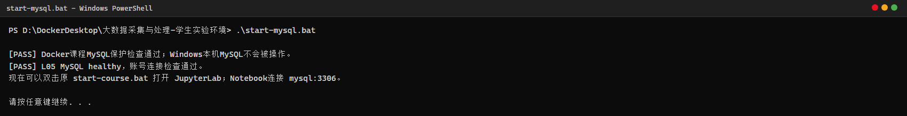

图1：`start-mysql.bat` 的启动输出。保护检查通过后显示 `[PASS] L05 MySQL healthy，账号连接检查通过`，说明课程 MySQL 容器已就绪且 student 账号可以连接。

### 启动环境与建表

依次使用 `start-course.bat`、`start-mysql.bat`、`mysql-console.bat` 启动课程环境、数据库和 MySQL 终端。

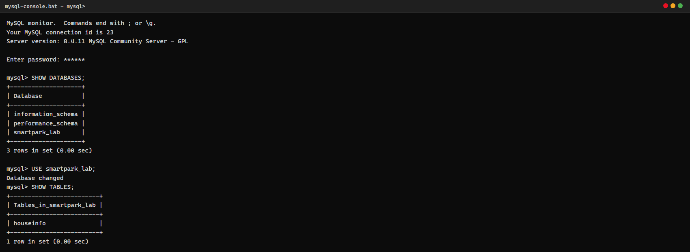

图2：MySQL 终端中 `SHOW DATABASES` 能看到 `smartpark_lab`，`USE smartpark_lab` 后 `SHOW TABLES` 确认当前库中还没有房源表。

建表执行指导书给出的 `CREATE TABLE IF NOT EXISTS houseinfo (...)` 完整 SQL（含 `id` 自增长主键和 8 个 VARCHAR 字段，字符集 `utf8mb4`）：

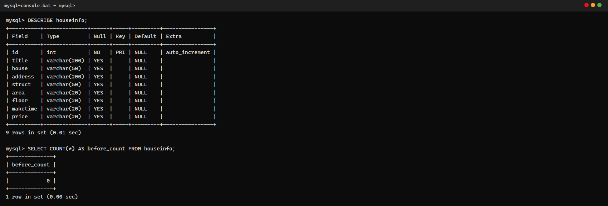

图3：`DESCRIBE houseinfo` 显示 9 列结构（id 为主键自增长），`SELECT COUNT(*) AS before_count` 记录入库前条数为 **0**。

说明：当前使用哪个数据库？`id` 和8个房源字段分别保存什么？

答：当前使用 `smartpark_lab` 数据库。`id` 是 `INT AUTO_INCREMENT PRIMARY KEY`，由数据库自动生成的自增长主键，不参与去重判断；其余 8 列按采集顺序保存房源信息：`title` 卖点标题、`house` 楼盘名称、`address` 详细地址、`struct` 户型（如“3室2厅1卫”）、`area` 建筑面积（保留单位）、`floor` 楼层（不是朝向）、`maketime` 建造年代（缺失时存空字符串）、`price` 每平方米单价（不是总价）。

## 第二阶段：房源采集与 CSV 数据存储

### 1. 网页分析与房源解析

#### 选择器是怎样得到的

在 Chrome 中按 F12，使用 **Elements → Copy → Copy selector**。以标题字段为例：点击第一条房源标题后复制到的是从 `#页面根节点` 开始、带多层 `>` 和 `:nth-child()` 的长路径。这种按位置选择的路径在页面多插入一个元素时就会失效，所以删掉长路径中间所有层级，只保留两级：

- 选择的字段：标题 `title`
- 复制的原始选择器：`#root > div:nth-child(3) > … > div.property-content-title > h3`（结构示意，完整值过长）
- 一条房源的父容器选择器：`div.property`
- 最终使用的相对选择器：`row.select_one("h3.property-content-title-name")`

图4：教学站真实列表页。红框标出的 `div.property` 节点恰好包住一条房源（标题、楼盘、地址、属性组、总价与单价都在其中），把鼠标悬停在高亮区域上即可确认边界；第二条房源使用相同的 class。

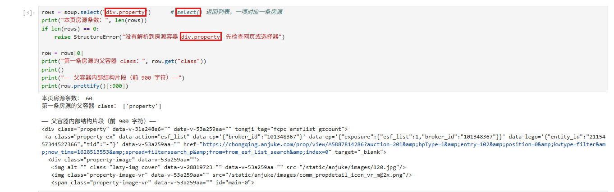

图5：Notebook 中 `soup.select("div.property")` 返回 60 条，`select()` 用于取“这一类”的所有节点；第一条房源的父容器 class 为 `['property']`。

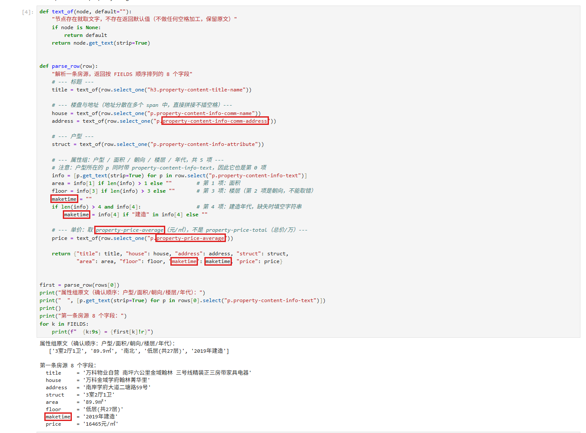

图6：解析函数 `parse_row()`。红框标出了地址选择器 `p.property-content-info-comm-address`（地址分散在多个 `span` 中，用 `get_text(strip=True)` 直接拼接、不主动插空格）、单价选择器 `p.property-price-average`（区分总价的 `property-price-total`），以及面积 `info[1]`、楼层 `info[3]`、建造年代 `info[4]` 的定位与缺失处理。

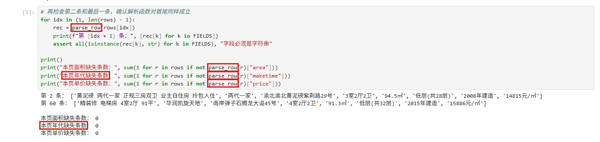

图7：用第 2 条和第 60 条复核解析函数，并统计本页面积/年代/单价缺失条数（均为 0）；取属性组前先确认列表长度，防止下标越界。

说明：两个选择方法各用在哪里？怎样确认面积和单价没有取错？

答：`select()` 用在“一层容器”上（`div.property`、`p.property-content-info-text`），返回列表，用于逐条遍历和统计属性组；`select_one()` 用在“唯一字段”上（标题、楼盘、地址、单价），返回第一个匹配节点，找不到时返回 `None`，所以配合 `text_of()` 先判空再取文字。面积和单价的确认方法：先把属性组 5 项原文打印出来，确认顺序是“户型/面积/朝向/楼层/年代”，面积取下标 1、楼层取下标 3（下标 2 是朝向，不能取错）；单价对照网页右侧显示的单位，取 `property-price-average` 的“16465元/㎡”而不是总价节点“148万”，首页 60 条全部有值且格式统一。

#### 网页原文对照（面积、单价、年代）

首条房源的属性组原文：`['3室2厅1卫', '89.9㎡', '南北', '低层(共27层)', '2019年建造']`，单价节点原文 `16465元/㎡`（见图4 红框与图6 输出）。

### 2. 下一页采集

- 下一页 `href` 原值：`?page=2`
- 用 `urljoin()` 补全后的地址：`http://www.bspider.top/anjuke/?page=2`
- 实际停止原因：明确禁用的末页按钮（第 10 页分页区仍存在，但找不到 `a.next.next-active`，据此判断到达末页，正常结束）

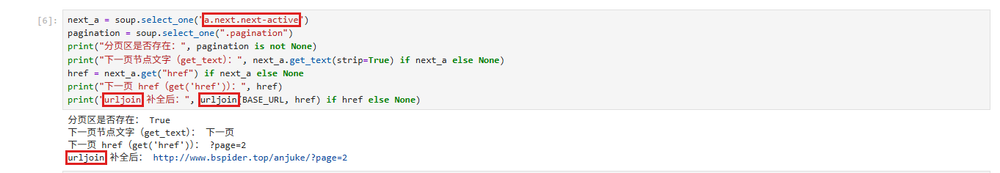

图8：红框标出 `a.next.next-active`、`get("href")` 与 `urljoin`。注意 `get_text()` 拿到的是“下一页”三个字，`get("href")` 拿到的才是地址 `?page=2`，补全后为绝对地址。

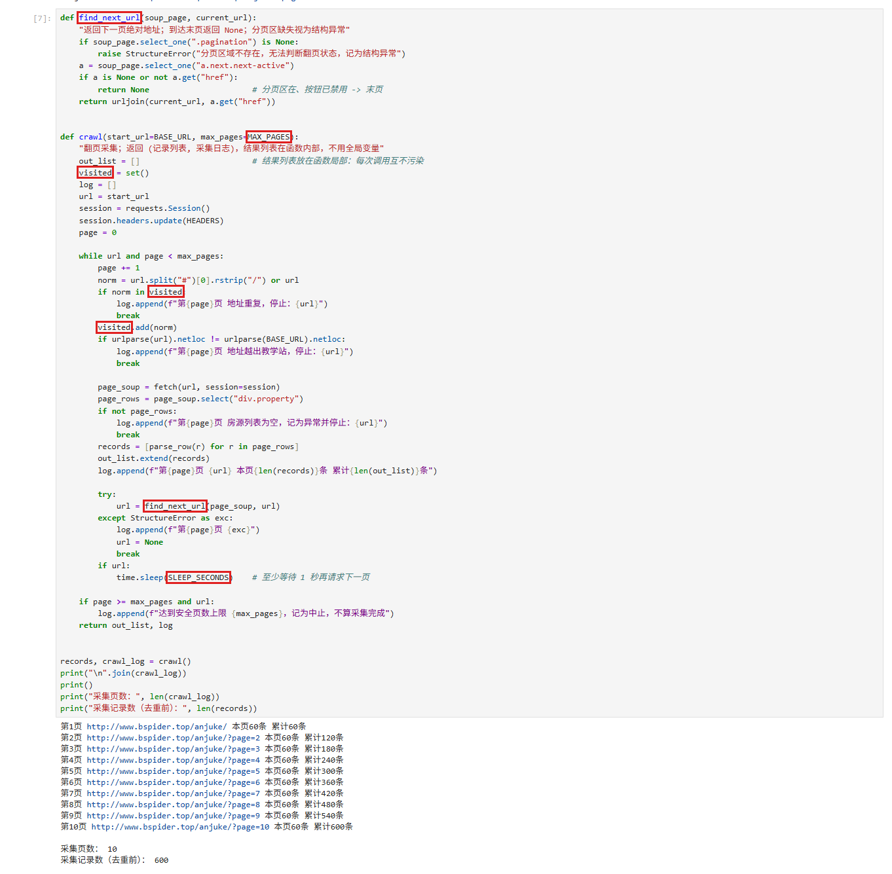

图9：分页循环 `crawl()`。红框标出 `find_next_url()`（翻页与停止判断）、`visited` 已访问集合（防重复地址）、`MAX_PAGES` 安全上限和 `SLEEP_SECONDS` 翻页间隔（至少 1 秒）。

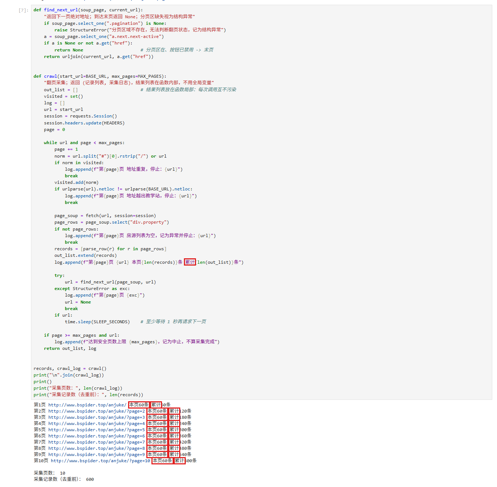

图10：真实翻页日志：第 1 页到第 10 页各 60 条，累计 600 条后正常停止；结果列表 `out_list` 定义在函数内部。

说明：怎样进入下一页？怎样防止重复采集或无限循环？若中途失败，说明停在哪一步。

答：每次解析完当前页，用 `select_one("a.next.next-active")` 找“下一页”按钮，取其 `href` 并用 `urljoin(当前地址, href)` 拼成绝对地址，赋回 `url` 进入下一页。防重复/防死循环有三层：①`visited` 集合按规范化地址判重，重复即停止；②`urlparse(url).netloc` 必须等于教学站域名，防止被带出站外；③`MAX_PAGES=30` 安全上限，达到只记为“中止”。停止条件的判断依据是“分页区仍存在但下一页按钮已禁用”才算末页——实验中验证过：直接请求 `?page=11` 会原样返回第 10 页的内容，所以不能用“还能请求到数据”判断是否采完。本次采集在第 10 页正常停止，无中途失败。

### 3. 保存 CSV

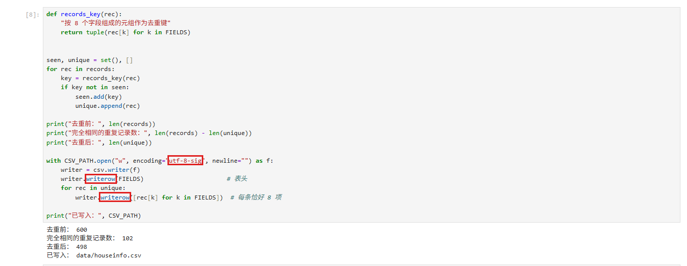

图11：用 `csv.writer` 保存，红框标出编码 `utf-8-sig`（Excel 打开不乱码）、`newline=""`（避免 Windows 下出现空行）和 `writerow`（先写表头，再逐条写 8 项）；保存前按 8 个字段完全相同去重。

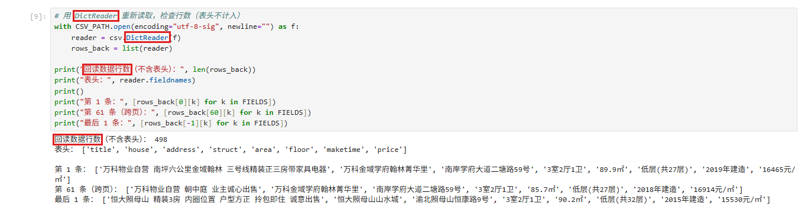

图12：用 `csv.DictReader` 重新读取，数据行数 498（表头不计入），并抽样第 1 条、第 61 条（跨页）、最后 1 条与网页逐字段核对。

说明：8个字段的顺序是什么？按8个字段完全相同去重后，保存了多少条记录？

答：字段顺序固定为 `title → house → address → struct → area → floor → maketime → price`，与数据库建表列顺序一致。采集共 600 条，按 8 个字段完全相同去重后剩余 **498** 条（重复 102 条为教学站跨页重复挂出的房源），CSV 写入 498 行数据 + 1 行表头。

## 第三阶段：MySQL 数据存储

本阶段读取第二阶段的 `data/houseinfo.csv`，把其中的数据写入 MySQL，不重新采集。

### 1. 读取 CSV 并入库

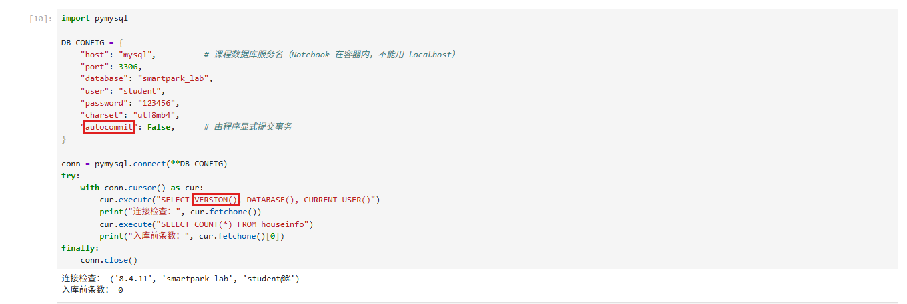

图13：连接检查。`host="mysql"` 是课程数据库服务名（Notebook 在容器内，不能用 localhost），`autocommit=False` 由程序显式提交事务；`SELECT VERSION(), DATABASE(), CURRENT_USER()` 返回 `8.4.11 / smartpark_lab / student@%`，确认连接正常，入库前条数 0。

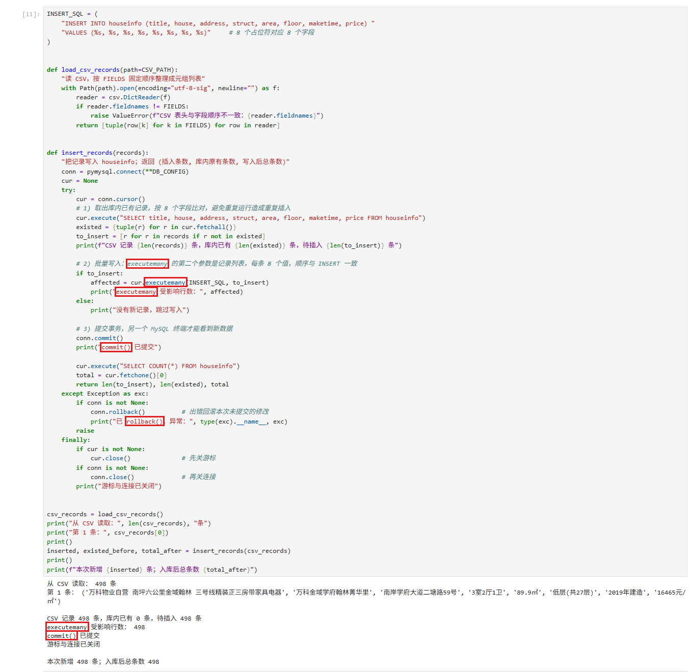

图14：入库程序。红框标出 `executemany()`（第二个参数是记录列表，每条 8 个值，顺序与 INSERT 的 8 个 `%s` 占位符一一对应，不做字符串拼接）、`conn.commit()`（提交后其他终端才能看到）、异常分支的 `conn.rollback()`，以及 `finally` 中先 `cur.close()` 再 `conn.close()`。避免重复插入的红框在第 1 步：先 `SELECT` 出库内已有记录组成集合，与 CSV 记录按 8 字段比对，只插入尚不存在的记录。

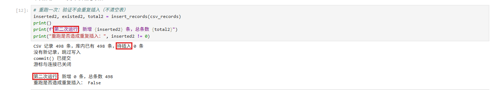

图15：关闭上次程序后，另起一个独立进程再次执行入库：CSV 498 条、库内已有 498 条、待插入 0 条，总条数保持 498，未清空表也未重复插入。

说明：每条记录怎样对应8个参数？成功、失败时分别做什么？再次运行时怎样避免重复插入？

答：INSERT 语句写明 8 个列名并放 8 个 `%s` 占位符，`executemany(INSERT_SQL, records)` 的 `records` 中每条是按 `FIELDS` 顺序组成的 8 元组，位置一一对应，值由 PyMySQL 参数化传入。成功路径：`executemany` 返回受影响行数后 `commit()` 提交，最后关闭游标和连接；失败路径：进入 `except` 先 `rollback()` 撤销本次未提交的修改，再抛出异常，`finally` 中无论成败都先关游标再关连接（连接可能未创建成功，所以先判 `is not None`）。再次运行时按 8 个字段取出库内已有记录做集合比对，只插入不存在的记录；自增长 `id` 挡不住重复房源，不能靠它去重，也绝不清空表重跑。

### 2. 核对结果

#### 查询条数和样本

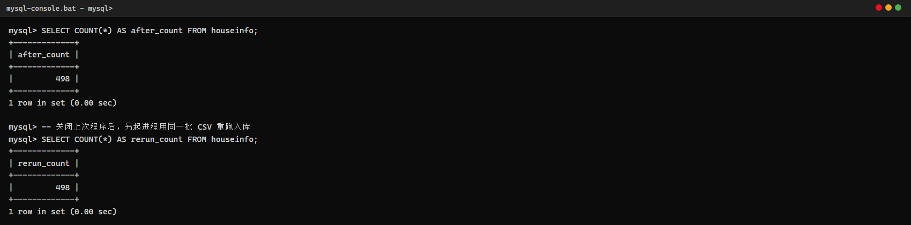

图16：MySQL 终端中 `after_count = 498`；独立重跑后 `rerun_count` 仍为 498，证明幂等。

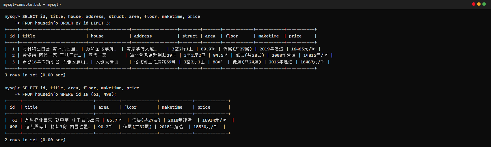

图17：`SELECT ... ORDER BY id LIMIT 3` 的前 3 条样本，以及跨页样本 id=61、末条样本 id=498 的字段值（查询时需加 `--default-character-set=utf8mb4`，否则中文显示为问号）。

| 项目 | 实际结果 |
|---|---|
| 成功采集页数 | 10 页（第 1~10 页，末页“下一页”按钮已禁用） |
| 采集记录数（去重前） | 600 |
| 完全相同的重复记录数 | 102 |
| CSV数据行数（不含表头） | 498 |
| 入库前条数 | 0 |
| 入库后条数 / 本次新增条数 | 498 / 498 |
| 关闭上次程序后，同批数据独立重跑的条数 / 新增条数 | 498 / 0 |
| 是否采集完整；未完成的原因 | 完整。分页区存在且末页“下一页”按钮已禁用，符合指导书的末页判定；无结构异常，未触发安全页数上限 |

说明：首次入库后的条数应等于去重后的CSV数据行数，8个字段的内容也应一致。若不一致，说明原因。总条数以实际结果为准。

答：一致。首次入库后 498 条 = 去重后 CSV 数据行数 498；Notebook 中用 `set(csv_records).issubset(db_rows)` 验证 CSV 每条记录都能在数据库中按 8 字段找到，498/498 全部命中（见图13 之后的核对单元格输出）。需要说明的是：在线教学站总计 600 条记录中本身含有 102 条跨页重复房源（不同页挂了同一套房），去重后为 498 条，因此总条数不是旧报告的 601 条，以实际采集为准。

#### 逐条核对

选取第一条、跨页一条和最后一条，比较网页、CSV与数据库中的8个字段。

- 样本1（第 1 页第 1 条，CSV 第 1 行，数据库 id=1）：`万科物业自营 南坪六公里金域翰林 三号线精装正三房带家具电器 / 万科金域学府翰林菁华里 / 南岸学府大道二塘路59号 / 3室2厅1卫 / 89.9㎡ / 低层(共27层) / 2019年建造 / 16465元/㎡`
- 样本2（第 2 页第 1 条，CSV 第 61 行，数据库 id=61）：`万科物业自营 朝中庭 业主诚心出售 / 万科金域学府翰林菁华里 / 南岸学府大道二塘路59号 / 3室2厅1卫 / 85.7㎡ / 低层(共27层) / 2018年建造 / 16914元/㎡`
- 样本3（第 10 页最后 1 条，CSV 末行，数据库 id=498）：`恒大照母山 精装3房 内圈位置 户型方正 拎包即住 诚意出售 / 恒大照母山山水城 / 渝北照母山恒康路9号 / 3室2厅1卫 / 90.2㎡ / 低层(共32层) / 2015年建造 / 15530元/㎡`

三条样本在图6/图12（网页与CSV）与图17（数据库）中可逐字段对照，红框标出了面积、单价和年代。

核对结论及差异：三处存储（网页原文、CSV、数据库）8 个字段完全一致，无差异。地址为多个 `span` 直接拼接（如“南岸学府大道二塘路59号”），面积保留“㎡”、单价保留“元/㎡”单位，建造年代为“XXXX年建造”格式，与网页原文一致。

## 问题与解决

- 遇到的问题、处理方法及结果：
  1. **访问验证页**：用指导书示例的 `User-Agent: Mozilla/5.0` 请求，返回 200 但内容是“访问验证-安居客”拦截页。解决：在请求头中补全完整 Chrome UA（含 Windows 版本号、WebView 内核标识），并升级 `Accept-Language` 等头；同时在 `fetch()` 里显式检测标题含“访问验证”即抛 `AntiSpamError`，避免把拦截页当数据解析。结果：在线采集成功，未使用快照。
  2. **网络抖动**：采集过程中出现两次 `ConnectionError/ReadTimeout`。解决：`fetch()` 内做 3 次重试、间隔 2 秒；翻页间 `time.sleep(1)` 限速。结果：重试后全部成功。
  3. **越界页码陷阱**：直接请求 `?page=11` 会原样返回第 10 页内容。解决：翻页只依据“下一页”按钮状态，不猜测页码，避免把重复页当作新数据。
  4. **MySQL 终端中文乱码**：`SELECT` 中文显示为 `?`。原因：客户端默认字符集不是 utf8mb4。解决：`mysql` 客户端加 `--default-character-set=utf8mb4` 后正常。
- 尚未解决的问题、未完成的步骤（没有可写“无”）：无。

## 思考题

1. 本次怎样实现下一页采集？结合自己的代码说明。

   答：在 `find_next_url()` 中先用 `select_one(".pagination")` 确认分页区存在（不存在直接抛 `StructureError`，不算采完），再用 `select_one("a.next.next-active")` 找处于激活状态的“下一页”按钮；用 `a.get("href")` 取地址（`get_text()` 只是“下一页”文字），由于 `href` 是 `?page=2` 这种相对形式，用 `urljoin(当前地址, href)` 补全成绝对地址后作为下一轮请求目标。停止条件是“分页区在、按钮消失/禁用”返回 `None` 正常结束；另有 `visited` 判重、域名白名单和 `MAX_PAGES=30` 上限三重保护，触发上限只记“中止”。

2. 旧代码把 out_list 定义在全局。你把结果列表放在哪里？为什么？

   答：放在 `crawl()` 函数内部作为局部变量，采集完成后通过 `return out_list, log` 返回给调用方。原因：①全局可变状态会让多次调用互相污染——重跑一次采集时旧数据还挂在全局列表上，容易造成重复统计；②把“采集”和“保存”解耦后，`crawl()` 只负责返回数据，写 CSV、入库都拿返回值操作，函数可以单独测试；③也避免与 Notebook 其他单元格的变量名冲突。

3. 你怎样获取建造年代？节点缺失或顺序改变时，怎样处理？

   答：建造年代在属性组 `p.property-content-info-text` 列表的第 4 项（前 4 项依次是户型、面积、朝向、楼层）。取值前先判断 `len(info) > 4` 且该项非空，再校验文字中含“建造”二字才赋值，否则 `maketime` 保持空字符串——节点缺失时填空串而不是报错或跳过整条记录。顺序改变时的防线：不按“最后一个 p”这种脆弱位置取，而是固定取属性组下标并校验内容特征；若未来属性组顺序变化导致校验失败，会体现为该字段批量变空串，在“本页年代缺失条数”的统计里能立刻暴露（本页为 0），便于发现后调整选择器。

## 提交检查

- [x] 实验一原仓库的 `lab02/` 中已有源码、CSV、报告和真实截图。
- [x] 截图清楚，关键代码已框出，每项附有个人解释。
- [x] GitHub上能打开文件和图片，未上传个人账号密码、`.env`或教师答案。
- [x] 未完成项已如实说明；学习通只交原仓库链接。

如使用 AI，简述它帮助了什么，以及自己修改、运行和核对了什么：

答：AI 帮助梳理了页面结构与选择器方案、生成了 Notebook 代码框架和本报告初稿。我自己完成了：在课程容器中实际运行采集（含处理访问验证页与重试）、核对每个字段与网页原文、用 MySQL 终端建表与验收（条数、样本、重跑）、逐张核对截图与数据是否一致，并把重复条数、越界页码等实际运行中出现的现象补进分析与思考题。
